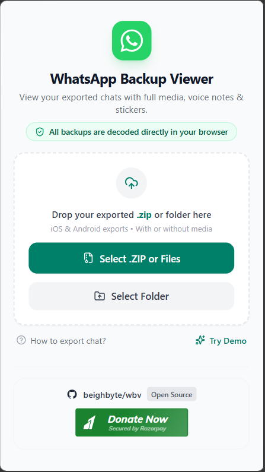
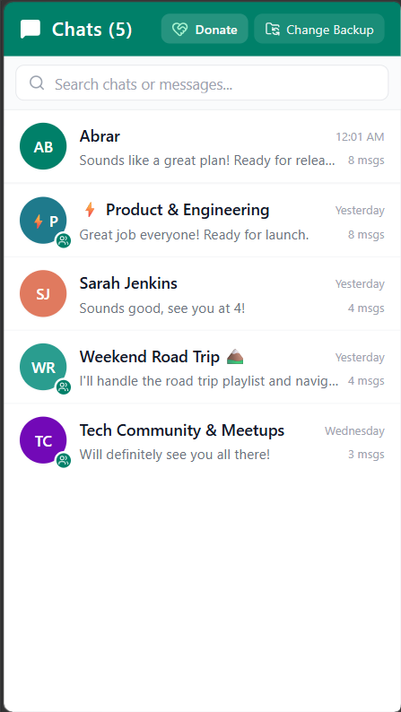
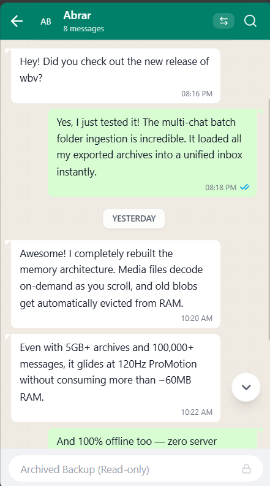

<div align="center">

# wbv
### Offline Chat Backup Viewer (for WhatsApp exports)

**The private, high-performance chat archive reader for your browser.**  
Open, search, and view exported WhatsApp chats (`.zip`, folders, `.txt`) with photos, audio notes, and videos.

Zero server uploads • Multi-chat folder support • Hardware-accelerated 120Hz+ • 100% Client-side

[](https://nextjs.org/)
[](https://react.dev/)
[](https://www.typescriptlang.org/)
[](LICENSE)
[](https://github.com/beighbyte/wbv)
[](https://razorpay.me/@beighbyte)

<br /><br />

| 1. Landing & Drag-and-Drop | 2. Multi-Chat Inbox | 3. Authentic Chat View |
| :---: | :---: | :---: |
|  |  |  |

</div>

---

## Why wbv?

Most existing WhatsApp backup viewers either upload your sensitive personal chats to a third-party server, or restrict you to opening only **one single `.txt` file at a time**.

**wbv is engineered differently:**

- **Multi-Chat Batch Ingestion** — Drop an entire folder containing dozens of chat exports or multiple `.zip` archives at once. `wbv` automatically detects, parses, and arranges every individual and group conversation into a searchable sidebar inbox with instant switching.
- **100% Offline & Private** — Zero server uploads. Runs entirely in your browser as a static web app. No backend, no API, no analytics. Your messages, photos, and voice notes never leave your computer or phone.
- **Engineered for Huge Archives (5GB+)** — Media is indexed lazily and decoded only when scrolled into view. An automatic LRU cache revokes older media from memory, keeping RAM usage ultra-lean (~60MB) even with thousands of photos.
- **Hardware-Accelerated Refresh Rate (120Hz+)** — Adapts directly to your display's refresh rate (90Hz, 120Hz, 144Hz+) using `@tanstack/react-virtual` with butter-smooth scrolling across 100,000+ messages (rendering only ~20 DOM nodes at a time).
- **Authentic WhatsApp Interface** — Speech bubble tails, sticky date chips, audio waveforms with 1.5x/2x speed, full-screen image lightbox, and dark mode.
- **Universal Android & iOS Parsing** — Automatically parses both Android (`\u202f` narrow spaces) and iOS bracketed exports, with one-click side swapping and perspective switching.

---

## Quick Start

```bash
# 1. Clone the repository
git clone https://github.com/beighbyte/wbv.git
cd wbv

# 2. Install dependencies
npm install

# 3. Start local development server
npm run dev
```

Open [http://localhost:3000](http://localhost:3000) and drag & drop:
- A single WhatsApp exported `.zip` file
- Multiple `.zip` files
- An entire unzipped backup folder containing multiple chats

---

## Self-Hosting & Production Build

To generate standalone static production files:

```bash
npm run build
```

The compiled static files are generated into the `out/` folder. Serve them with Nginx, Caddy, Apache, Docker, or any static file server.

---

## Support & Sponsor

If this tool helped you recover, archive, or browse your chat memories, consider supporting the project:

- **Razorpay:** [Donate / Buy a coffee](https://razorpay.me/@beighbyte)
- **GitHub:** Star the repository on [GitHub](https://github.com/beighbyte/wbv)

---

## Search Keywords

`whatsapp backup viewer` • `whatsapp chat reader` • `view exported whatsapp chat` • `whatsapp zip viewer` • `whatsapp txt viewer` • `offline whatsapp backup reader` • `whatsapp export viewer with media` • `multi chat whatsapp viewer` • `client side whatsapp reader`

---

## Disclaimer

This is an independent open-source project and is not affiliated with, endorsed by, or sponsored by WhatsApp LLC, Meta Platforms, Inc., or any of their affiliates. "WhatsApp" is a registered trademark of WhatsApp LLC.

---

## License

[MIT](LICENSE)