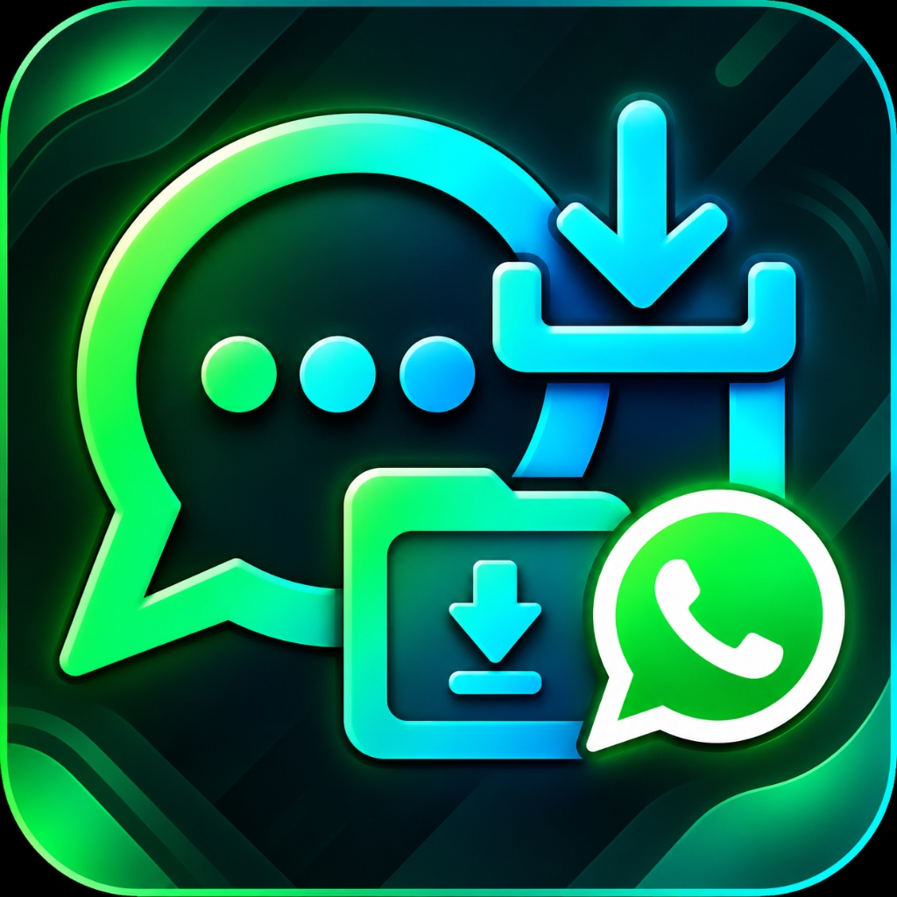

<div align="center">
  <h1>
    
    wbv
  </h1>
  <h3>Offline Chat Backup Viewer (for WhatsApp exports)</h3>

  <p><strong>The private, high-performance chat archive reader for your browser.</strong><br />
  Open, search, and view exported WhatsApp chats (<code>.zip</code>, folders, <code>.txt</code>) with photos, audio notes, and videos.</p>

  <p>Zero server uploads • Multi-chat folder support • Hardware-accelerated 120Hz+ • 100% Client-side</p>

 

  <p>
    <a href="https://free-whatsapp-backup-viewer.vercel.app/"></a>
    <a href="https://nextjs.org/"></a>
    <a href="https://react.dev/"></a>
    <a href="https://www.typescriptlang.org/"></a>
    <a href="LICENSE"></a>
    <a href="https://github.com/beighbyte/wbv"></a>
  </p>
</div>

---

<div align="center">

| 1. Landing & Drag-and-Drop | 2. Multi-Chat Inbox | 3. Authentic Chat View |
| :---: | :---: | :---: |
|  |  |  |

</div>

<p align="center">
    <a href="https://free-whatsapp-backup-viewer.vercel.app/">
      
    </a>
  </p>

---

## Why wbv?

Most existing WhatsApp backup viewers either upload your sensitive personal chats to a third-party server, or restrict you to opening only **one single `.txt` file at a time**.

**wbv is engineered differently:**

- **Multi-Chat Batch Ingestion** — Drop an entire folder containing dozens of chat exports or multiple `.zip` archives at once. `wbv` automatically detects, parses, and arranges every individual and group conversation into a unified, searchable inbox with instant switching.
- **100% Offline & Private** — Zero server uploads. Runs entirely in your browser as a static web app. No backend, no API, no analytics. Your messages, photos, and voice notes never leave your computer or phone (you can even disconnect your Wi-Fi).
- **Magic-Byte File Sniffing** — Deeply inspects binary headers (`PK\x03\x04`, JPEG, PNG, Opus/Ogg, PDF, UTF-8 transcripts) to identify archives, chats, and media even if file extensions were lost or stripped during transfer.
- **Smart Self-Identity Detection** — Automatically determines who you are in group chats via 1-on-1 consensus voting and deletion fingerprint tracking (`"You deleted this message"`), displaying your bubbles in green on the right and others on the left.
- **Authentic WhatsApp Interface & Markdown** — Includes curved SVG speech bubble tails, inline floating timestamps, sticky date chips, audio waveforms with 1.5x/2x playback, edited message badges (`Edited`), full WhatsApp markdown formatting (`*bold*`, `_italics_`, `~strike~`, `` `code` ``, `> quotes`), and clickable links.
- **Lazy Video Playback & Performance** — Video messages render with lightweight thumbnail posters, frosted-glass play buttons (`▶`), and duration badges, preventing hardware decoder exhaustion while scrolling.
- **Zero-Lag Search Highlighting** — Real-time search across conversations and message transcripts with instant yellow match highlighting.
- **Mobile-Optimized & Native Back Navigation** — Full hardware Back button and gesture support on Android and iOS (pressing back closes the chat or photo lightbox without accidentally exiting the website).
- **Engineered for Huge Archives (5GB+)** — Media is indexed lazily and decoded only when scrolled into view. An automatic LRU cache evicts older media from memory, keeping RAM usage ultra-lean (~60MB) even with thousands of photos.
- **Hardware-Accelerated 120Hz+ Scrolling** — Adapts directly to your display's refresh rate (90Hz, 120Hz, 144Hz+) using `@tanstack/react-virtual` across 100,000+ messages (rendering only ~20 DOM nodes at a time).
- **Universal Android & iOS Parsing** — Seamlessly parses both Android (`\u202f` narrow spaces) and iOS bracketed exports, with one-click side swapping and manual perspective switching.

---

## Try It Online

You can use the viewer instantly without installing anything:

👉 **[Launch Live App — free-whatsapp-backup-viewer.vercel.app](https://free-whatsapp-backup-viewer.vercel.app/)**

---

## Local Development

```bash
# 1. Clone the repository
git clone https://github.com/beighbyte/wbv.git
cd wbv

# 2. Install dependencies
npm install

# 3. Start local development server
npm run dev
```

Open [http://localhost:3000](http://localhost:3000) and drag & drop:
- A single WhatsApp exported `.zip` file
- Multiple `.zip` files
- An entire unzipped backup folder containing multiple chats

---

## Self-Hosting & Production Build

To generate standalone static production files:

```bash
npm run build
```

The compiled static files are generated into the `out/` folder. Serve them with Nginx, Caddy, Apache, Docker, or any static file server.

### Install and use offline

The production build includes a web app manifest, install icons, and a service worker that precaches the exported app. Serve the site over HTTPS (or localhost), open it once while online, and install it from your browser's install or add-to-home-screen option. The app shell then remains available offline.

WhatsApp backups are not stored by the service worker: select or drop your backup again after launching the app offline.

---

## Support

If this tool helped you recover, archive, or browse your chat memories, consider supporting the project:

- **Razorpay:** [Donate / Buy a coffee](https://razorpay.me/@beighbyte)
- **GitHub:** Star the repository on [GitHub](https://github.com/beighbyte/wbv)

---

## Search Keywords

`whatsapp backup viewer` • `whatsapp chat reader` • `view exported whatsapp chat` • `whatsapp zip viewer` • `whatsapp txt viewer` • `offline whatsapp backup reader` • `whatsapp export viewer with media` • `multi chat whatsapp viewer` • `client side whatsapp reader`

---

## Disclaimer

This is an independent open-source project and is not affiliated with, endorsed by, or sponsored by WhatsApp LLC, Meta Platforms, Inc., or any of their affiliates. "WhatsApp" is a registered trademark of WhatsApp LLC.

---

## License

[MIT](LICENSE)